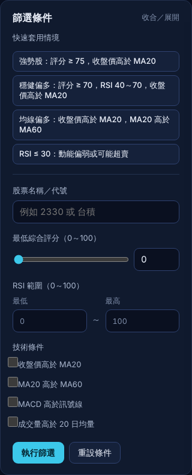
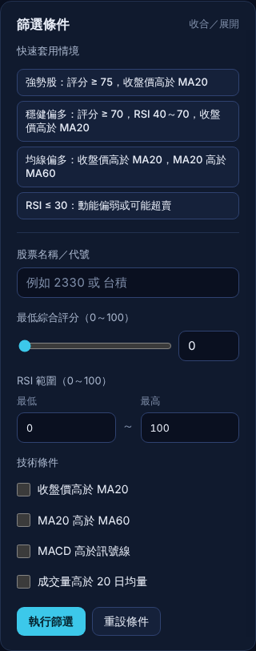
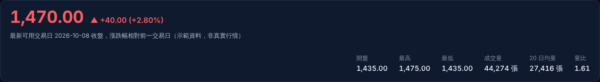
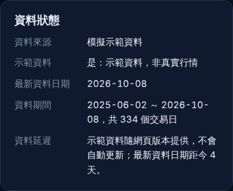
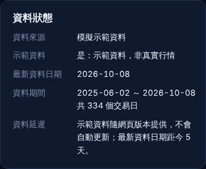
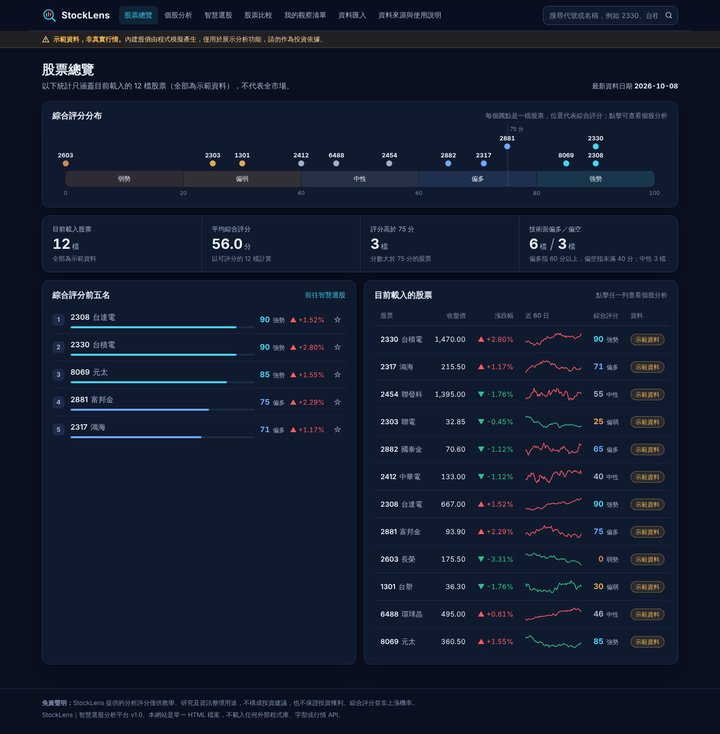
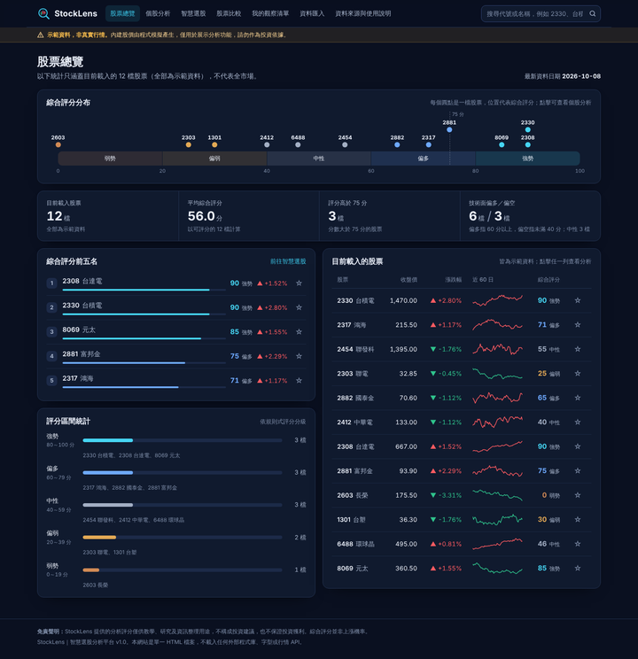

# StockLens AI 協作紀錄

本文件記錄 StockLens 如何透過 AI（Claude）依照[規格書](規格書.md)完成實作、測試、修正與公開部署。依規格書第九章的要求，只記錄實際完成的開發與測試。

- 網站連結：https://ytomfang.github.io/TAICA_HW_StockLens/
- 開發方式：AI 輔助 Vibe Coding（AI 工具：Claude）

## 一、協作流程

| 階段 | 實際完成內容 |
|---|---|
| 規格書 | 與 AI 討論網站目標、功能與使用情境，整理成[規格書](規格書.md) |
| 核心邏輯 | 依規格書 4.3～4.8 節實作示範資料、MA／RSI／MACD／量比／報酬率、規則式綜合評分與 CSV 驗證，先用單元測試確認數值正確 |
| 介面與圖表 | 完成七個頁面；K 線、成交量、RSI、MACD 與比較走勢圖都用 Canvas 自行繪製；深色主題並支援手機 |
| 測試與修正 | 用自動化瀏覽器逐項執行規格書第八章的驗收測試，檢視桌面與手機截圖，依結果反覆修改 |
| 公開部署 | 上傳 GitHub、啟用 GitHub Pages、修正 repo 名稱，並在瀏覽器實際操作公開網址 |

## 二、反覆調整紀錄

### 1. 示範資料調整

- **問題：** 第一版的 12 檔示範股票，沒有任何一檔落在「中性」（40～59 分），RSI 也沒有高於 70 或低於 30 的例子，無法示範過熱、超賣與各評分區間。
- **修改：** 調整模擬資料的亂數種子，讓五個評分區間都有股票，並包含 RSI 73.5（過熱）與 24.9（超賣）的例子。規格書情境二（評分 ≥ 75 且收盤價高於 MA20）與流程二（評分 ≥ 70、RSI 40～70、收盤價高於 MA20）各能篩出 4 檔。

### 2. RSI 計算驗證

- **問題：** 用 StockCharts 公開的 RSI 範例比對時，第一筆 RSI 算出 70.46，與參考值 70.53 不符。
- **修改：** 查出是測試資料的收盤價只取到小數 2 位；改用範例的完整精度後，19 筆 RSI 全部吻合（誤差小於 0.01），確認 Wilder 平滑法實作正確。

### 3. 智慧選股篩選面板

- **問題：** 技術條件的勾選框和文字錯位（被其他欄位標籤的 CSS 規則覆蓋）；RSI 輸入框的數字顏色太暗，看起來像沒有填寫。
- **修改：** 修正 CSS 選擇器，並設定輸入文字顏色。

| 修改前 | 修改後 |
|---|---|
|  |  |

### 4. 個股分析頁排版

- **問題：** 報價區的價格和右側數據之間留下大片空白；資料狀態卡的日期在中間斷行（2026-10- ／ 08）。
- **修改：** 報價與數據改為同一列排列；日期區間設定為不換行。

**報價區修改前**

**報價區修改後**

| 資料狀態修改前 | 資料狀態修改後 |
|---|---|
|  |  |

### 5. 比較圖日期刻度

- **問題：** 標準化走勢圖左邊緣的日期被截斷，「07/09」只顯示「7/09」。
- **修改：** 刻度文字限制在圖表範圍內。

| 修改前 | 修改後 |
|---|---|
|  |  |

### 6. 股票總覽版面

- **問題：** 左欄在「綜合評分前五名」下方留下大片空白。
- **修改：** 新增「評分區間統計」卡片，列出各評分區間的股票。

| 修改前 | 修改後 |
|---|---|
|  |  |

### 7. 手機版修正

- **問題：** 在 390px 寬的手機畫面上，股票總覽與股票比較頁可以左右滑動（頁面寬度分別變成 637px 與 558px），原因是表格內給螢幕閱讀器的隱藏文字和評分分布圖的提示框超出畫面。
- **修改：** 修正定位方式，提示框改為滑鼠移入時才顯示並靠邊對齊，修正後所有頁面寬度都是 390px。另外把表格第一欄固定、導覽列加上可捲動提示、示範資料橫幅改為短句，並把輸入框字級調為 16px，避免 iPhone 自動放大。

### 8. 圖表標籤重疊

- **問題：** RSI 圖右側的最新數值標籤蓋住「70」刻度。
- **修改：** 數值標籤附近的刻度文字改為不顯示。

### 9. 部署修正

- **問題：** GitHub repo 名稱誤植為 StockLems，網址跟著拼錯。
- **修改：** repo 改名為 TAICA_HW_StockLens，並同步更新 README 的網站連結。

## 三、測試結果

| 測試 | 結果 |
|---|---|
| 單元測試 | 28 項全部通過：均線、EMA、RSI 邊界值與公開範例、MACD 起算位置、不使用未來資料、資料不足顯示 N/A、評分各級距邊界值、CSV 驗證規則 |
| 獨立交叉驗證 | 另用 Python 重寫 MA、RSI、MACD，與網頁計算結果逐筆比對，相對誤差小於 10⁻¹⁴ |
| 驗收測試（規格書第八章） | 自動化瀏覽器在桌面版與手機版（390×844）共 54 項全部通過；評分細項與篩選結果都和 Python 獨立計算的答案一致 |
| 按鈕檢查 | 逐一點擊 82 個可見按鈕，每個都有實際作用 |
| 邊界測試 | 只有 1 筆或 2 筆資料、70 天完全平盤、日期倒序且含千分位、含 HTML 標籤的錯誤資料，都能正確處理，不會當機 |
| 公開網址 | GitHub 上的 index.html 與測試通過的檔案完全相同；在瀏覽器開啟公開網址，搜尋、K 線期間與均線切換、評分細項、選股、比較、觀察清單與 CSV 匯入都能正常操作，沒有 JavaScript 錯誤 |
