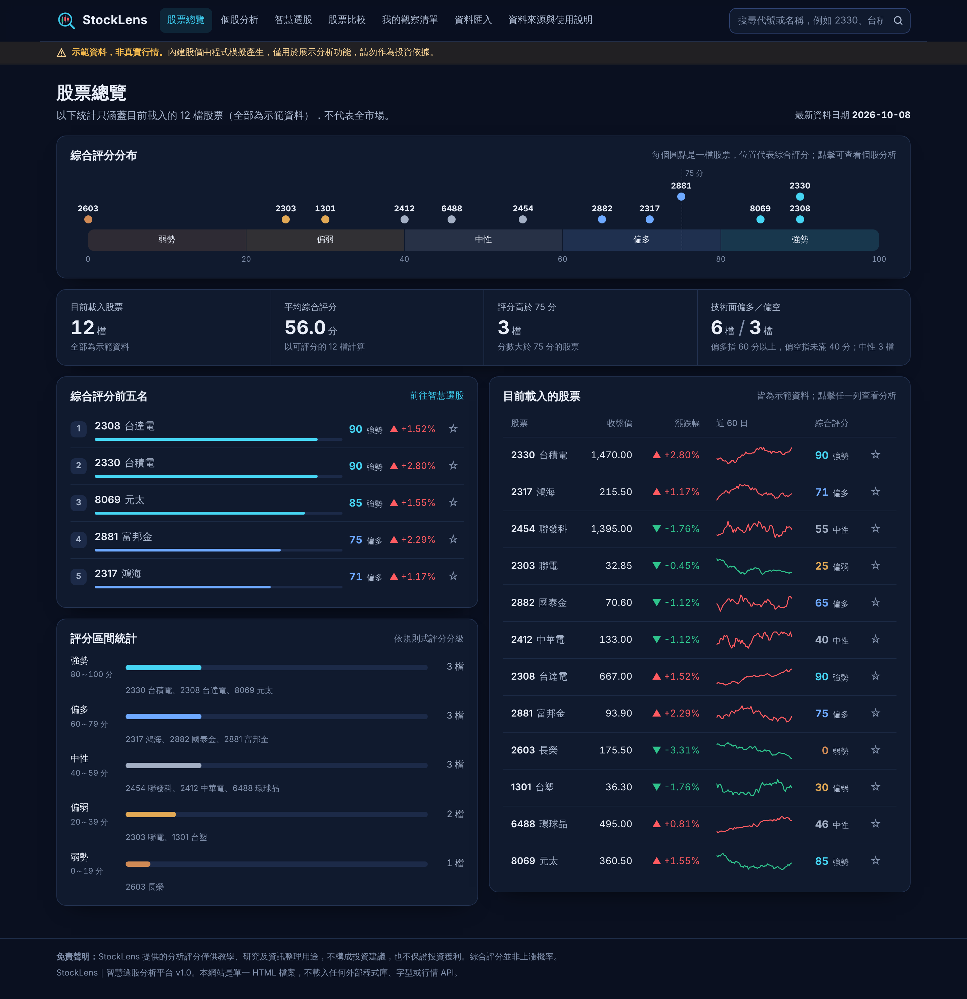
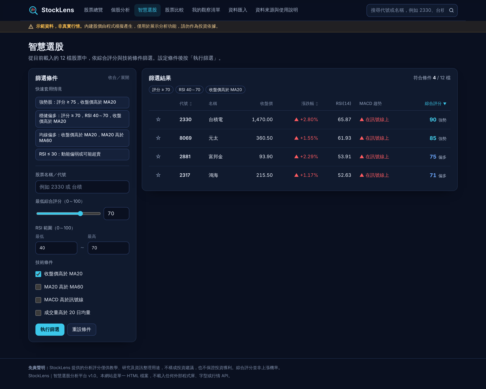

# StockLens｜智慧選股分析平台

互動式台股技術分析與智慧選股網站：K 線圖、MA／RSI／MACD／成交量指標、規則式綜合評分、條件選股、股票比較、觀察清單與 CSV 匯入。

**網站連結：** https://ytomfang.github.io/TAICA_HW_StockLens/

**文件：** [規格書](規格書.md)｜[AI 協作紀錄](AI協作紀錄.md)（實際修改前後對照與測試結果）

> 內建股價為程式模擬的示範資料，非真實行情。本網站僅供教學、研究及資訊整理用途，不構成投資建議，也不保證投資獲利。

## 功能

| 頁面 | 內容 |
|---|---|
| 股票總覽 | 載入股票數、平均綜合評分、評分高於 75 分的檔數、技術面偏多／偏空統計、評分前五名 |
| 個股分析 | K 線圖（1 個月～1 年）、MA5／MA20／MA60 開關、RSI(14)、MACD(12, 26, 9)、成交量、綜合評分與細項理由、訊號解釋與風險提示 |
| 智慧選股 | 依名稱／代號、最低評分、RSI 範圍、均線、MACD 與成交量條件篩選，結果可依評分、漲跌幅與代號排序 |
| 股票比較 | 最多三檔並排比較，標準化價格走勢只使用共同交易日對齊 |
| 我的觀察清單 | 點擊 ☆ 加入，以 LocalStorage 儲存，重新整理後仍保留 |
| 資料匯入 | 上傳 `Date,Open,High,Low,Close,Volume` 格式的 CSV，逐行驗證後計算指標與評分 |
| 資料來源與使用說明 | 資料類型、各股資料狀態、指標公式與評分規則 |

## 綜合評分模型

透明、可解釋的規則式模型，範圍 0～100 分：趨勢 40 分、動能 RSI 25 分、MACD 25 分、成交量 10 分。資料少於 60 個交易日時顯示「資料不足，無法評分」，不強行給分。綜合評分並非上漲機率。

## 技術架構

- 單一 `index.html`：HTML5、CSS3、JavaScript，圖表以 Canvas 自行繪製
- 不使用外部程式庫、CDN、字型或行情 API；不需要後端伺服器、帳號系統或資料庫
- 觀察清單使用 LocalStorage；CSV 以 File API 在瀏覽器內讀取，不會上傳

## 本機使用

下載 `index.html`，直接用瀏覽器開啟即可。

## 截圖

**股票總覽**

**K 線圖與技術指標**

**智慧選股**

